<!-- Generated by tools/profile (python3 tools/profile/profile.py). Edit config.json or the generator, not this file. -->

<picture><source media="(max-width: 600px) and (prefers-color-scheme: light)" srcset="./assets/profile/phone/light/header.svg"><source media="(max-width: 600px)" srcset="./assets/profile/phone/dark/header.svg"><source media="(prefers-color-scheme: light)" srcset="./assets/profile/light/header.svg"></picture>
<a href="https://matrix.to/#/@james:authelia.com"><picture><source media="(max-width: 600px) and (prefers-color-scheme: light)" srcset="./assets/profile/phone/light/link-1.svg"><source media="(max-width: 600px)" srcset="./assets/profile/phone/dark/link-1.svg"><source media="(prefers-color-scheme: light)" srcset="./assets/profile/light/link-1.svg"></picture></a><a href="https://www.authelia.com"><picture><source media="(max-width: 600px) and (prefers-color-scheme: light)" srcset="./assets/profile/phone/light/link-2.svg"><source media="(max-width: 600px)" srcset="./assets/profile/phone/dark/link-2.svg"><source media="(prefers-color-scheme: light)" srcset="./assets/profile/light/link-2.svg"></picture></a><a href="https://github.com/sponsors/james-d-elliott"><picture><source media="(max-width: 600px) and (prefers-color-scheme: light)" srcset="./assets/profile/phone/light/link-3.svg"><source media="(max-width: 600px)" srcset="./assets/profile/phone/dark/link-3.svg"><source media="(prefers-color-scheme: light)" srcset="./assets/profile/light/link-3.svg"></picture></a>
<picture><source media="(max-width: 600px) and (prefers-color-scheme: light)" srcset="./assets/profile/phone/light/telemetry.svg"><source media="(max-width: 600px)" srcset="./assets/profile/phone/dark/telemetry.svg"><source media="(prefers-color-scheme: light)" srcset="./assets/profile/light/telemetry.svg"></picture>
<picture><source media="(max-width: 600px) and (prefers-color-scheme: light)" srcset="./assets/profile/phone/light/city.svg"><source media="(max-width: 600px)" srcset="./assets/profile/phone/dark/city.svg"><source media="(prefers-color-scheme: light)" srcset="./assets/profile/light/city.svg"></picture>
<picture><source media="(max-width: 600px) and (prefers-color-scheme: light)" srcset="./assets/profile/phone/light/projects.svg"><source media="(max-width: 600px)" srcset="./assets/profile/phone/dark/projects.svg"><source media="(prefers-color-scheme: light)" srcset="./assets/profile/light/projects.svg"></picture>
<a href="https://github.com/authelia/authelia"><picture><source media="(max-width: 600px) and (prefers-color-scheme: light)" srcset="./assets/profile/phone/light/project-1.svg"><source media="(max-width: 600px)" srcset="./assets/profile/phone/dark/project-1.svg"><source media="(prefers-color-scheme: light)" srcset="./assets/profile/light/project-1.svg"></picture></a><a href="https://github.com/go-webauthn/webauthn"><picture><source media="(max-width: 600px) and (prefers-color-scheme: light)" srcset="./assets/profile/phone/light/project-2.svg"><source media="(max-width: 600px)" srcset="./assets/profile/phone/dark/project-2.svg"><source media="(prefers-color-scheme: light)" srcset="./assets/profile/light/project-2.svg"></picture></a>
<a href="https://github.com/go-crypt/crypt"><picture><source media="(max-width: 600px) and (prefers-color-scheme: light)" srcset="./assets/profile/phone/light/project-3.svg"><source media="(max-width: 600px)" srcset="./assets/profile/phone/dark/project-3.svg"><source media="(prefers-color-scheme: light)" srcset="./assets/profile/light/project-3.svg"></picture></a><a href="https://github.com/go-krb5/krb5"><picture><source media="(max-width: 600px) and (prefers-color-scheme: light)" srcset="./assets/profile/phone/light/project-4.svg"><source media="(max-width: 600px)" srcset="./assets/profile/phone/dark/project-4.svg"><source media="(prefers-color-scheme: light)" srcset="./assets/profile/light/project-4.svg"></picture></a>
<a href="https://github.com/authelia/oauth2-provider"><picture><source media="(max-width: 600px) and (prefers-color-scheme: light)" srcset="./assets/profile/phone/light/project-5.svg"><source media="(max-width: 600px)" srcset="./assets/profile/phone/dark/project-5.svg"><source media="(prefers-color-scheme: light)" srcset="./assets/profile/light/project-5.svg"></picture></a><a href="https://github.com/authelia/saml-provider"><picture><source media="(max-width: 600px) and (prefers-color-scheme: light)" srcset="./assets/profile/phone/light/project-6.svg"><source media="(max-width: 600px)" srcset="./assets/profile/phone/dark/project-6.svg"><source media="(prefers-color-scheme: light)" srcset="./assets/profile/light/project-6.svg"></picture></a>
<a href="https://github.com/authelia/jose-provider"><picture><source media="(max-width: 600px) and (prefers-color-scheme: light)" srcset="./assets/profile/phone/light/project-7.svg"><source media="(max-width: 600px)" srcset="./assets/profile/phone/dark/project-7.svg"><source media="(prefers-color-scheme: light)" srcset="./assets/profile/light/project-7.svg"></picture></a><a href="https://github.com/go-spop/spop"><picture><source media="(max-width: 600px) and (prefers-color-scheme: light)" srcset="./assets/profile/phone/light/project-8.svg"><source media="(max-width: 600px)" srcset="./assets/profile/phone/dark/project-8.svg"><source media="(prefers-color-scheme: light)" srcset="./assets/profile/light/project-8.svg"></picture></a>
<picture><source media="(max-width: 600px) and (prefers-color-scheme: light)" srcset="./assets/profile/phone/light/releases.svg"><source media="(max-width: 600px)" srcset="./assets/profile/phone/dark/releases.svg"><source media="(prefers-color-scheme: light)" srcset="./assets/profile/light/releases.svg"></picture>
<a href="https://github.com/authelia/authelia/stargazers"><picture><source media="(max-width: 600px) and (prefers-color-scheme: light)" srcset="./assets/profile/phone/light/stars.svg"><source media="(max-width: 600px)" srcset="./assets/profile/phone/dark/stars.svg"><source media="(prefers-color-scheme: light)" srcset="./assets/profile/light/stars.svg"></picture></a>
<picture><source media="(max-width: 600px) and (prefers-color-scheme: light)" srcset="./assets/profile/phone/light/beyond.svg"><source media="(max-width: 600px)" srcset="./assets/profile/phone/dark/beyond.svg"><source media="(prefers-color-scheme: light)" srcset="./assets/profile/light/beyond.svg"></picture>
<a href="https://hub.docker.com/r/authelia/authelia"><picture><source media="(max-width: 600px) and (prefers-color-scheme: light)" srcset="./assets/profile/phone/light/pulls.svg"><source media="(max-width: 600px)" srcset="./assets/profile/phone/dark/pulls.svg"><source media="(prefers-color-scheme: light)" srcset="./assets/profile/light/pulls.svg"></picture></a>
<a href="https://github.com/pulls?q=is:pr+is:merged+author:james-d-elliott+-org:authelia+-org:go-webauthn+-org:go-crypt+-org:go-krb5+-org:go-spop+-user:james-d-elliott"><picture><source media="(max-width: 600px) and (prefers-color-scheme: light)" srcset="./assets/profile/phone/light/upstream.svg"><source media="(max-width: 600px)" srcset="./assets/profile/phone/dark/upstream.svg"><source media="(prefers-color-scheme: light)" srcset="./assets/profile/light/upstream.svg"></picture></a>
<picture><source media="(max-width: 600px) and (prefers-color-scheme: light)" srcset="./assets/profile/phone/light/credentials.svg"><source media="(max-width: 600px)" srcset="./assets/profile/phone/dark/credentials.svg"><source media="(prefers-color-scheme: light)" srcset="./assets/profile/light/credentials.svg"></picture>
<picture><source media="(max-width: 600px) and (prefers-color-scheme: light)" srcset="./assets/profile/phone/light/jwt.svg"><source media="(max-width: 600px)" srcset="./assets/profile/phone/dark/jwt.svg"><source media="(prefers-color-scheme: light)" srcset="./assets/profile/light/jwt.svg"></picture>
<picture><source media="(max-width: 600px) and (prefers-color-scheme: light)" srcset="./assets/profile/phone/light/revoke.svg"><source media="(max-width: 600px)" srcset="./assets/profile/phone/dark/revoke.svg"><source media="(prefers-color-scheme: light)" srcset="./assets/profile/light/revoke.svg"></picture>

Regenerated daily by <code>tools/profile</code>. Console layout inspired by <a href="https://github.com/jdx/jdx">@jdx</a> and <a href="https://github.com/pboling/pboling">@pboling</a>; contribution city after <a href="https://github.com/georgekobaidze/georgekobaidze">Giorgi Kobaidze</a>.

